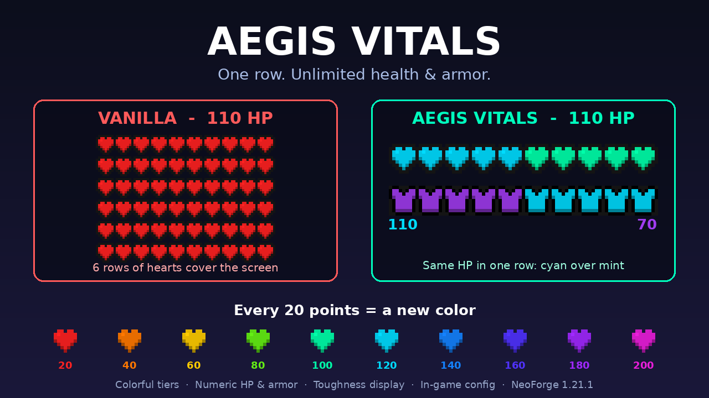

# Aegis Vitals

A client-side Minecraft mod that replaces the stacked vanilla health and armor rows with **one row each**, colored by tier. Every 20 points moves the bar to a new color, so a player with hundreds of hearts or armor points still sees a single clean row.

## Features

- **Single-row health bar.** Health plus absorption is split into tiers of 20 HP. The current tier's color is drawn over the previous tier's, so you can read both at a glance.
- **Single-row armor bar** with its own metallic and gem palette. You can turn it off to keep the vanilla armor bar.
- **No limit on tiers.** The first 32 tiers have hand-picked colors. Above that, every tier gets its own generated color.
- **Numbers next to the bars.** Health and armor values can be shown, tinted with the current tier's color, with armor toughness alongside.
- **Plays nicely with other HUD mods.** It can take priority over other health/armor HUD mods, step aside when one is installed, or be switched off.
- **Client-only.** Install it on your own game. Servers don't need it, and it works on any server.

## Requirements

| | |
|---|---|
| Minecraft | 1.21.1 |
| Mod loader | NeoForge 21.1.x (built against 21.1.65) |
| Java | 21 |
| Side | Client only |

## Installation

1. Install NeoForge for Minecraft 1.21.1.
2. Download `AegisVitals-neoforge-1.21.1-<version>.jar` from the releases (or CurseForge).
3. Put the jar in your `.minecraft/mods` folder and start the game.

## Configuration

Edit the settings in-game from **Mods → Aegis Vitals → Config**, or in `config/aegis_vitals-client.toml`.

| Option | Default | Description |
|---|---|---|
| `hudMode` | `AEGIS_PRIORITY` | `AEGIS_PRIORITY`: Aegis draws the bars and hides other mods' health/armor HUD layers. `AUTO`: Aegis turns itself off when a known health-HUD mod is installed (Overflowing Bars, Colorful Hearts, Classic Bar, Health Overlay, Tiered Hearts). `DISABLED`: vanilla HUD. |
| `showNumericHealth` | `true` | Show the health value left of the hearts. |
| `showNumericArmor` | `true` | Show the armor value left of the armor icons. |
| `colorSyncNumericText` | `true` | Tint the numbers with the current tier's color. |
| `showArmorToughness` | `true` | Show armor toughness next to the armor value. |
| `enableTieredArmor` | `true` | Draw the single-row tiered armor bar instead of the vanilla one. |

## Building from source

See [DEVELOPING.md](DEVELOPING.md).

## License

Aegis Vitals is licensed under the [GNU General Public License v3.0](LICENSE).
